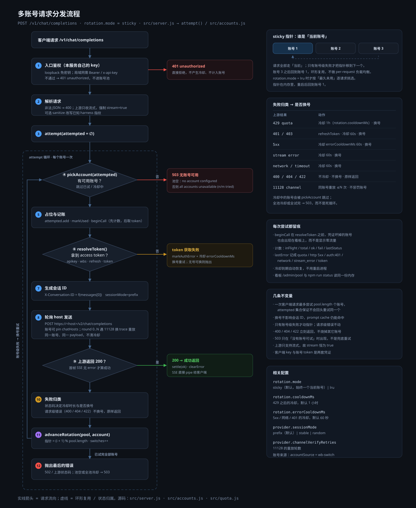

# 落地实现方案（bridge-ai · CodeBuddy 专用中继）

> ⚠️ **范围**：本文描述 `bridge-ai` 的**实际实现**，仅面向 Tencent CodeBuddy CLI（`@tencent-ai/codebuddy-code`）。
> 不支持 Claude Code / Codex / Kimi Code。早期基于 Kimi Code 的设想（Hono 草图、mock 后端等）**均未实现**，实际仅支持 CodeBuddy。

## 架构总览

```
OpenAI 兼容客户端 / CodeBuddy 自定义端点 (OPENAI_BASE_URL=http://...:8787/v1)
        │  POST /v1/chat/completions  (OpenAI 格式, 建议 stream=true)
        ▼
bridge (src/server.js · 原生 node:http，默认监听 127.0.0.1:8787，可绑 0.0.0.0)
        ├─ 可选 serverApiKey 网关（缺失/错误返回 401，除 /healthz 外）
        ├─ 解析 OpenAI messages / tools
        ├─ 强制 upstream stream=true（CodeBuddy 仅支持流式）
        ├─ 账号池轮转 + 冷却（src/accounts.js）
        ├─ 解析 token（src/auth-codebuddy.js：refresh / apikey / token / import）
        └─ 转发上游（src/proxy.js）
              ├─ 注入身份头 + Authorization: Bearer <accessToken>
              ├─ 多主机故障切换 wb.tencentbuddy.com → copilot.tencent.com
              ├─ SSE 透传 + char-code（ASCII 码串）解码回退
              └─ 首段 SSE 窥探，遇 error 事件则本账号内失败切换一次
```

配套：`src/quota.js`（状态码/流内错误分类 + 账号轮转判定）、`src/util.js`（路径展开、脱敏）、`src/index.js`（CLI：`server`/`login`/`status`/`scan`，并把轮转后的 refresh token 持久化到 `bridge.state.json`）。

## 关键事实（实测）

### 上游端点
- 聊天：`https://wb.tencentbuddy.com/v2/chat/completions`（主），`https://copilot.tencent.com/v2/chat/completions`（备）。
  - ⚠️ 路径是 `/v2/chat/completions`，**不是** `/v1/` 也不是裸 `/chat/completions`。
  - 上游**只接受流式**：bridge 在转发前把请求体强制 `stream:true`；若上游收到非流式会返回 `400 "Non-stream chat request is currently not supported"`。
  - 接收侧（客户端访问 bridge）路径仍是标准 OpenAI `/v1/chat/completions`——这是给客户端的兼容层，与上游路径不同，属正常。

### 身份头（除 Authorization 外必带）
- `Authorization: Bearer <accessToken>`
- `X-Product: SaaS`
- `X-Domain: www.codebuddy.cn`
- `X-User-Id: <uid>`
- `x-codebuddy-request: 1`

### 双 token 模型
- **access token**：RS256，`typ:Bearer`，约 28 天，作为聊天请求 Bearer。
- **refresh token**：HS512，`typ:Offline`，约 30 天，作为 `X-Refresh-Token` 头调用 `POST /v2/plugin/auth/token/refresh`；响应 `{code:0, data:{accessToken, refreshToken, expiresIn, refreshExpiresIn, ...}}`，**且该接口会回吐新的 refresh token（轮转）**，必须持久化新值。
- CodeBuddy **不**把这两套 token 以明文落盘 `~/.codebuddy`，故 `import` 模式无法读取——改用 `refresh`（推荐）或 `apikey`。

## 认证模式（src/auth-codebuddy.js）

| mode | 说明 |
|------|------|
| `refresh` | **推荐**。用离线 refresh token 调 `/v2/plugin/auth/token/refresh` 换 access token，并把轮转后的 refresh token 持久化到 `bridge.state.json`（由 `src/index.js` 注入 `_persistRefreshToken`）。带 ~30s/到期前缓存，401 触发重换。 |
| `apikey` | CodeBuddy 控制台生成的 API key，最持久省事，无需刷新。 |
| `token` | 直接粘贴静态 access token（escape hatch）。 |
| `import` | 递归扫描 `~/.codebuddy` 抓 token；**对 CodeBuddy 不生效**（token 不落盘明文），仅占位。 |

## 账号池与轮转（src/accounts.js / src/quota.js）



图源：`docs/request-flow.svg`（改动了 `handleChat` / `attempt()` / 轮转逻辑后请同步更新）。

- 默认 `rotation.mode = "sticky"`：进程里只有一个「当前账号」指针 `rotation.index`，所有请求都走它；只有**账号级失败**才 `advanceRotation` 把指针移到下一个，环形复用。`lru` 保留旧行为（每请求挑最久未用的账号）。
- 选号 `selectByRotation` 会跳过本请求已试过的 `attempted` 集合与冷却中的账号；全池冷却或试完 → `503 all accounts unavailable (n/m tried, k cooling)`；池空 → `503 no account configured`。
- `429` → `markExhausted(rotation.cooldownMs，默认 1h)`，换号。
- `401/403` → 清 token 缓存 + `markAuthError(errorCooldownMs，默认 60s)`，换号；账号级错误不再试该账号的其它主机。
- `5xx` / SSE 流错误 / 网络超时 → `markExhausted(errorCooldownMs)`，换号。
- `400/404/422` → 请求本身有问题，**不冷却、不换号**，原样回给客户端。
- `11128`（渠道校验）→ 同一账号换 trace 头重放 `provider.channelVerifyRetries` 次，仍失败则返回，不惩罚账号。
- 一次客户端请求最多尝试 `pool.length` 个账号（`attempted` 去重），不会无限重试。
- 多主机按 `provider.hosts` 顺序故障切换；账号可 pin `chatHosts`（国际版走自己的 host）。
- 会话 ID 由 `provider.sessionMode` 决定（默认 `prefix`：取 `messages[0]` 摘要），**换号不影响会话 ID**，prompt cache 仍能命中。
- 每次尝试都先 `beginCall` 再取 token，所以凭证损坏的账号也会出现在看板计数里；`/admin/pool` 与 `npm run status` 读同一份内存态。
- `logOutgoingBody`（默认关）可临时打印实际发给上游的 body（截断 8KB）用于核对，用完请改回，避免落盘对话内容。

## 部署（src/index.js + 腾讯云）

CLI 子命令：`server` / `login` / `status` / `scan`。`refresh` 模式会把轮转后的 refresh token 写回 `bridge.state.json`，跨重启保持自持。

- 部署在腾讯云（`tx` SSH 别名）`/opt/bridge-ai`，监听 `0.0.0.0:8787`。
- 公网暴露：安全组放行 TCP `8787` + 设 `listen.serverApiKey`（`Bearer` 或 `x-api-key` 校验）。
- 或 SSH 隧道：`ssh -N -L 8787:127.0.0.1:8787 tx`（推荐，不开安全组）。

## 辅助脚本（scripts/）

- `capture-token.mjs`：MITM 抓取 CodeBuddy CLI 的 refresh token + userId（改 `/etc/hosts` + 占 `:443`，需 root），写回 config.json 并复原 hosts。一次性使用，bridge 之后自行刷新+轮转。
- `capture-prompt.mjs`：MITM 抓取 CodeBuddy CLI 的系统提示词 + 23 个 tool 定义，落盘到 `/tmp/bridge_cb_prompt`；只读观察，不改 bridge 文件。

> **Token 计量提示**：bare API 会在服务端附带约 21 token 的默认上下文（不出现在请求体里）；15KB 的 agent 系统提示 + 23 个工具由 **CLI 客户端**发送，不是本 bridge 命中的 bare API 发出。

## 合规

反代复用订阅额度可能触及厂商 ToS 限制。个人自用、私有链路、不开公网、不多人共用风险最低；量产前务必评估合规。
